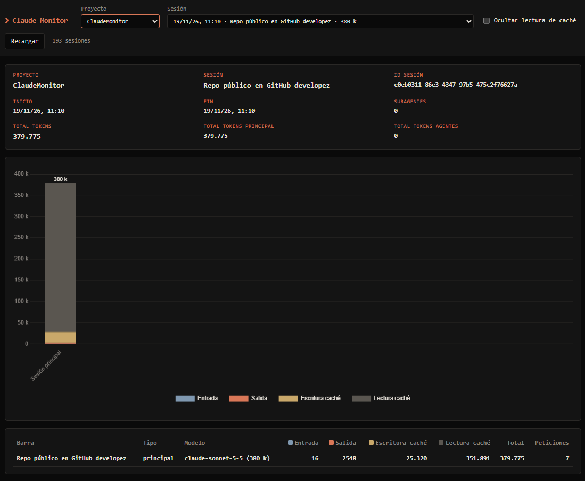

# Claude Monitor

Consumo de tokens de Claude Code por sesión y subagente, con tema oscuro estilo terminal.



Todo se calcula en el navegador a partir de los transcripts `.jsonl` de Claude Code. No hay backend ni dependencias que instalar (Chart.js va incluido en `vendor/`).

Versión hermana para Codex: [CodexMonitor](https://github.com/developez/CodexMonitor).

## Arranque rápido

Solo necesitas **Python 3**. Si no lo tienes, instálalo desde [python.org/downloads](https://www.python.org/downloads/). En Windows, marca la casilla **"Add python.exe to PATH"** durante la instalación.

1. Descarga el proyecto: botón verde **Code → Download ZIP** en GitHub, y descomprímelo donde quieras.
2. Arráncalo:
   - **Windows:** doble clic en `start.bat`.
   - **Linux / macOS:** abre una terminal en la carpeta y ejecuta `sh start.sh`.
3. Se abre el navegador en **http://localhost:8050/**. Si no se abre, escribe esa dirección a mano.

Para pararlo, cierra la ventana negra (Windows) o pulsa `Ctrl+C` en la terminal.

El script hace dos cosas: enlaza la carpeta de transcripts de Claude Code (`~/.claude/projects`, o `$CLAUDE_CONFIG_DIR/projects` si lo tienes definido) como `claude-projects`, y sirve la carpeta en el puerto 8050. El servidor solo escucha en tu equipo (`127.0.0.1`), así que nadie más de tu red puede verlo.

> ¿Usas también Codex Monitor? Los dos usan el puerto 8050, así que no pueden estar abiertos a la vez. Cambia `PORT=8050` en el `start` de uno de ellos.

## Configuración opcional

Por defecto se muestran todos los proyectos. Para limitarlos o darles nombre, copia `config.example.json` a `config.json` y pon tus carpetas:

```json
{
  "folders": ["C:/Projects/Acme"],
  "names": { "C:/Projects/Acme/web": "Acme · web" }
}
```

## Arranque manual

Si prefieres hacerlo tú:

```powershell
# Windows (PowerShell)
New-Item -ItemType Junction -Path claude-projects -Target "$env:USERPROFILE\.claude\projects"
python -m http.server 8050 --bind 127.0.0.1
```

```bash
# Linux / macOS
ln -s ~/.claude/projects claude-projects
python3 -m http.server 8050 --bind 127.0.0.1
```

Vale cualquier servidor estático que genere listados de directorio con el formato de `python -m http.server`.

## Qué muestra

- Tokens por sesión desglosados en entrada, salida, escritura de caché y lectura de caché.
- Una barra por la sesión principal y otra por cada subagente, con modelo y número de peticiones.
- Pestaña **En el tiempo**: consumo diario o por tramos de **1, 3, 8 o 12 horas**, agrupado por tipo de token o por modelo, en tokens o en euros. Los tramos se alinean desde medianoche con la hora local del navegador; los huecos del periodo aparecen a cero. En los cambios de horario, las horas locales repetidas se suman en el mismo tramo.
- Filtros **Desde** y **Hasta** en **En el tiempo**, con ambos días incluidos. Por defecto muestran los **últimos tres días** (hoy y los dos anteriores, según la hora local). El gráfico, los totales, las medias y el número de sesiones se ajustan al periodo; puedes dejar una fecha vacía para no limitar ese extremo.
- Interruptor **Franjas día / noche** en las vistas por horas: fondo azul con sol para el día (**08:00–20:00**) e índigo con luna y estrellas para la noche (**20:00–08:00**), en hora local. Son franjas horarias fijas, no horas astronómicas de amanecer y atardecer. Los bloques que cruzan esos límites se dividen visualmente sin alterar los datos.
- Coste estimado en euros con las tarifas oficiales de la API. Es el equivalente de pago por uso, no lo que cobra tu plan.
- Tabla de **precios por modelo** al final de la página. Los modelos sin tarifa publicada usan una tarifa estimada: el promedio de los modelos con precio que aparecen en tus datos.
- Filtro por proyecto y sesión, y opción de ocultar la lectura de caché.

Al abrir o recargar la página por primera vez tras actualizar a la versión con granularidad horaria, se descarta la caché diaria anterior y se releen los transcripts automáticamente. Las siguientes cargas reutilizan la nueva caché; no hace falta borrar los datos del navegador.

## Cómo se cuentan los tokens

Cada respuesta del modelo aparece en varias líneas del transcript, una por bloque de contenido. Se cuenta una sola vez, por `message.id` + `requestId`, y se usa la última línea, que trae la salida final. Los subagentes tienen su propio transcript y sus mensajes no se repiten en el principal.

Cada tipo de token se cobra a su tarifa:

| Tipo | Tarifa |
|---|---|
| Entrada | entrada |
| Salida | salida |
| Escritura de caché de 5 min | 1,25 × entrada |
| Escritura de caché de 1 h | 2 × entrada (se separa con `cache_creation.ephemeral_1h_input_tokens`) |
| Lectura de caché | 0,1 × entrada aprox. (0,05 × en Opus 5.5) |

La lectura de caché es casi siempre la mayor parte de los tokens, pero una parte pequeña del coste. Haiku 5.5 pasa a su tarifa larga en las peticiones de más de 100.000 tokens de prompt, petición a petición. No se contemplan el modo rápido (`speed: "fast"`) ni las búsquedas web, que tienen recargo.

### Límites conocidos

- **Sesiones retomadas o bifurcadas.** La sesión nueva copia el historial de la anterior, y las peticiones copiadas se suman en las dos. En la pestaña *En el tiempo* eso infla el total en torno a un 1 %: medido el 2026-11-21, 142 de 14.456 peticiones, unos 19 M de 1.766 M de tokens y unos 9 € de 705 €. Se asume este error.
- **Historial limitado.** Claude Code borra los transcripts con más de 30 días (`cleanupPeriodDays`), así que el monitor no ve nada anterior. Para conservar más, pon por ejemplo `"cleanupPeriodDays": 365` en `~/.claude/settings.json`.

## Privacidad

`claude-projects` y `config.json` están en `.gitignore`: contienen tus conversaciones y rutas locales y no deben subirse.
